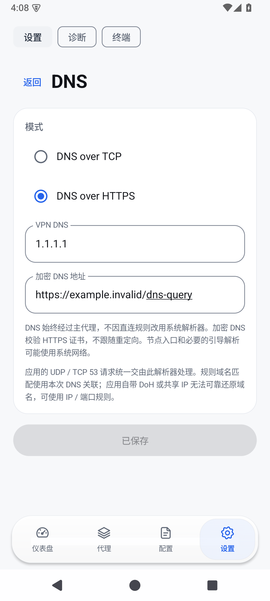

# PingClash

A privacy-focused Android proxy client powered by Mihomo, with connection diagnostics and a built-in terminal.

**Version: 0.1.0-beta.1 · Android 10+ · arm64-v8a / x86_64 · GPL-3.0-only**

## Features

- Subscription and local configuration management; preserves supported original policy groups and nested selections.
- Rootless Android VPN powered by Mihomo.
- Connection diagnostics, cancellable parallel latency testing and redacted reports.
- DNS over TCP / HTTPS, application routing, local outbound rules and live traffic information.
- Standard Android `sh` terminal with PTY, keyboard input, pipes, redirection and Ctrl+C.
- Configurations encrypted locally with Android Keystore and AES-GCM. No telemetry or advertisements.

## 状态与边界

这是首个公开 Beta，功能仍在完善。支持的配置是受限子集，远程 provider、部分规则和复杂筛选尚未支持；请勿视为完整 Mihomo 配置兼容保证。模拟器验证不能替代真实设备和网络测试。

终端使用本应用的 UID 和权限，可按用户输入读写应用文件及访问网络。系统命令的网络请求不等于经过所选节点。设备缺少的 curl、dig 等工具目前不额外打包。

不包含内置订阅、账号或节点凭据。使用你自己的服务和配置。

## Build and documentation

- [Build instructions](docs/development.md)
- [Terminal](docs/terminal.md)
- [Diagnostics](docs/diagnostics.md)
- [Privacy](PRIVACY.md) · [Security](SECURITY.md) · [Validation](docs/security-testing.md)
- [Licenses and attribution](NOTICE.md)

This repository contains the current source, tests and build scripts. Local toolchains, signing keys, user configurations, APKs and historical source archives are excluded. Release signing creates a new private local identity; upstream project signing keys are never distributed.

## Screenshots

Synthetic emulator data only; no personal subscription or credentials are shown.

| Dashboard | Proxies | Settings | DNS |
| --- | --- | --- | --- |
|  |  |  |  |

## Development status

See the [checklist review](docs/hardening-review.md), [documentation index](docs/README.md) and [changelog](CHANGELOG.md). Provider support, automatic network reconnection and complete Android resource localization remain under development. The CI configuration and dependency-update proposals do not constitute a security certification.
