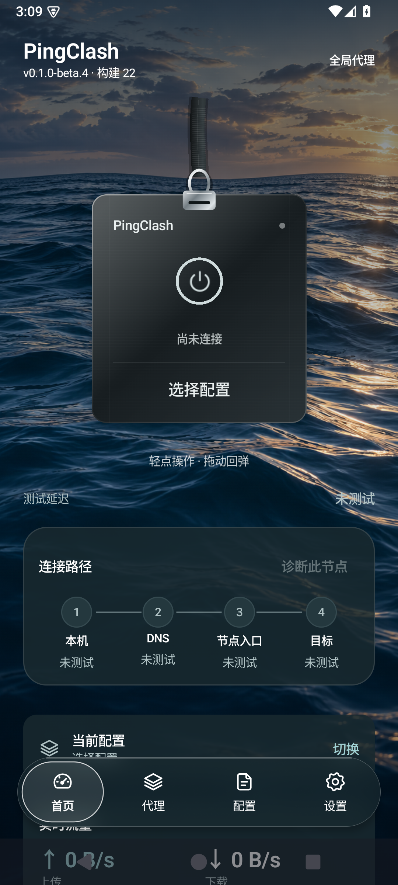
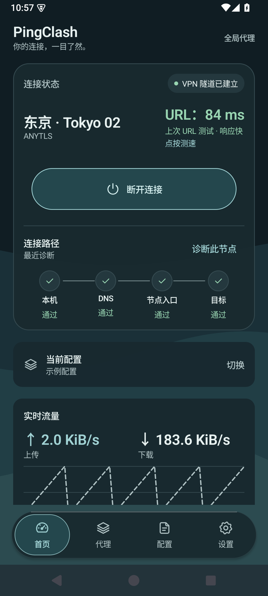
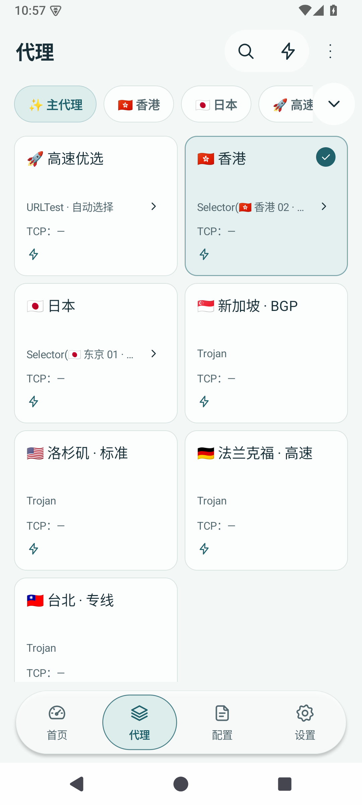
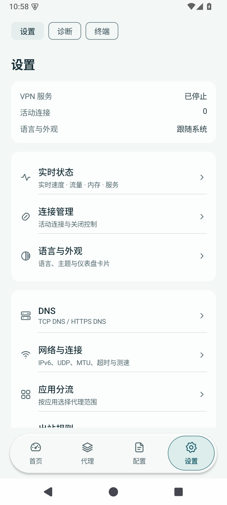

# PingClash

A privacy-focused Android proxy client powered by Mihomo, with connection diagnostics and a built-in terminal.

[Download 0.1.1](https://github.com/Jiangz1Ryaa259/Pingclash/releases/tag/v0.1.1) · [Earlier pre-release](https://github.com/Jiangz1Ryaa259/Pingclash/releases/tag/v0.1.0-beta.1)

**Current source: 0.1.2-preview.1 (build 31) · Android 10+ · arm64-v8a / x86_64 · App code GPL-3.0-only; renderer licenses in [NOTICE](NOTICE.md)**

## Features

- Subscription management with per-profile User-Agent, quota/expiry display and a bounded HTTP provider subset; preserves supported original policy groups and nested selections.
- Rootless Android VPN powered by Mihomo.
- Connection diagnostics, separate direct TCP and native Mihomo URL latency metrics, cancellable parallel testing and redacted reports.
- DNS over TCP / HTTPS, application routing, local outbound rules and live traffic information.
- Standard Android `sh` terminal with PTY, keyboard input, pipes, redirection and Ctrl+C.
- Configurations encrypted locally with Android Keystore and AES-GCM. No telemetry or advertisements.
- English / Simplified Chinese resources, Android 13+ system app-language settings, and automatic network reconnection with TUN retained during outages.
- Full-screen procedural animated ocean/clouds on Android 13+, animated photographic fallback on Android 10–12, circular light/dark reveal and Backdrop-powered refractive glass navigation on Android 13+. Reduced motion/transparency and protected-window fallbacks remain available.
- A non-scrolling, responsive home: draggable VPN card, top session capsule with auto-collapsing actions, configuration/routing mode and 2–4 website latency tiles. Expand the panel for 12 targets; tests run only on demand through native Mihomo URLTest. Theme switching lives in Appearance settings. Compact quota cards, scroll-collapsing import button and sensitive subscription-copy feedback.
- Top-anchored hanging card using the supplied React Bits geometry, PBR materials, woven normals and physics in an isolated offline Three.js renderer. Native Compose retains long-press input, VPN actions and accessibility; unsupported WebGL devices use a native fallback.

## 状态与边界

已发布版本为 0.1.1；当前源码为 0.1.2-preview.1，改善主页 3D 卡片返回时的连续性，尚未发布新的 Release。早期版本为 0.1.0-beta.1（预发布）。功能仍在完善。支持的配置是受限子集，HTTP providers 已实现受限首版；file/inline/MRS、部分规则和复杂筛选尚未支持；请勿视为完整 Mihomo 配置兼容保证。模拟器验证不能替代真实设备和网络测试。

终端使用本应用的 UID 和权限，可按用户输入读写应用文件及访问网络。系统命令的网络请求不等于经过所选节点。设备缺少的 curl、dig 等工具目前不额外打包。

不包含内置订阅、账号或节点凭据。使用你自己的服务和配置。

## Build and documentation

- [Build instructions](docs/development.md)
- [Terminal](docs/terminal.md)
- [Diagnostics](docs/diagnostics.md)
- [Privacy](PRIVACY.md) · [Security](SECURITY.md) · [Validation](docs/security-testing.md)
- [Licenses and attribution](NOTICE.md)

This repository contains the current source, tests and build scripts. Local toolchains, signing keys, user configurations, APKs and historical source archives are excluded. Release signing creates a new private local identity; upstream project signing keys are never distributed.

## Screenshots

Synthetic emulator data only; no personal subscription or credentials are shown. These screenshots show the earlier beta.6 layout; beta.7 reorganizes Home and Profiles. Any sample passing path or latency illustrates layout, not a real network measurement. See [UI design and accessibility](docs/ui-design.md).

| Front face | Reverse face (synthetic renderer fixture) | Proxies | Settings |
| --- | --- | --- | --- |
|  |  |  |  |

## Development status

See the [checklist review](docs/hardening-review.md), [documentation index](docs/README.md) and [changelog](CHANGELOG.md). HTTP providers, separate TCP latency metrics and subscription quotas/custom User-Agent now have an initial implementation; see the [supported subscription/provider subset](docs/subscriptions.md). QR and image import remain deferred. The implemented feature subset and automated checks do not constitute a security certification.

## 已测试环境

| 环境 | 系统 | 已有证据 |
| --- | --- | --- |
| 本地 AOSP x86_64 模拟器 | Android 15 / API 35 | beta.11/build 29 同一签名候选 64 项通过、0 跳过；含切页翻面、真实背景折射、点击残影对照、任务预览保护和 VPN 转发 |
| 本地 AOSP x86_64 模拟器 | Android 12 / API 31 | beta.11 同一签名候选 16 项玻璃回退、任务预览保护、对比度和交互专项通过；此项不是完整 VPN/WebGL 测试 |
| 本地 AOSP x86_64 模拟器 | Android 10 / API 29 | beta.11 同一签名候选 16 项不透明回退、任务预览及交互专项通过；旧 WebView 的三维能力不作保证 |
| GitHub CI AOSP 矩阵 | Android 12–15 / API 31、33、34、35 | 本轮以 PR #16 当前提交的 Actions 为准，不沿用旧提交绿色状态 |

具体构建、范围和 APK 校验值见[验证记录](docs/security-testing.md)，公共源码审查见 [PR #16](https://github.com/Jiangz1Ryaa259/Pingclash/pull/16)。当前没有开发者直接完成的国产 OEM 物理机测试，未将未知机型列为已验证。

仪表盘会显示在最近任务中；Android 13+ 禁用该卡片的页面快照，终端和敏感页面继续保护截屏。最近任务卡片与前台 VPN 通知是两项独立功能，移除卡片不会自动断开 VPN。网络切换会重建出站连接；若希望系统杀进程期间也阻断直连，请参考[后台、始终开启 VPN 与锁定模式](docs/background-vpn.md)。

本轮 HTTP providers、UA/配额及 TCP 指标的源码与验证见 [PR #14](https://github.com/Jiangz1Ryaa259/Pingclash/pull/14) 和[验证记录](docs/security-testing.md)。既有 Release APK 尚未更新。

HTTPS `clash://install-config` imports now require host confirmation and remain inactive until a separate profile selection. See the [provider compatibility corpus](docs/provider-compatibility.md), [output privacy boundaries](docs/output-privacy.md) and [next-beta notes draft](docs/next-beta-notes.md). These source additions do not replace the published beta.1 APK.
